# Repos

Public repositories you own, ordered by stars. Forks are left out.

An SVG for a GitHub profile. Place the URL in a README, on a site, or anywhere an image is allowed.

## Contents

- [Usage](#usage)
- [Themes](#themes)
- [Sizes](#sizes)
- [Parameters](#parameters)
- [Examples](#examples)
- [Generate files](#generate-files)
- [Run locally](#run-locally)
- [Deploy](#deploy)
- [Configuration](#configuration)
- [Private data](#private-data)
- [Contributing](#contributing)

## Usage

```text
https://github.com/itsrealkaran/nothing-github-repos?username=itsrealkaran
```

```md

```

Leave `theme` and `size` off for the classic regular card. It has a hairline border and a small corner. An unknown username, theme, or size still returns an SVG, so the image slot in a README stays intact.

## Themes

| Theme | Background | Mark |
| --- | --- | --- |
| `classic` | Pure Black `#000000` | white |
| `classic-r` | Pure Black `#000000` | N-Red `#C8102E` |
| `white` | Pure White `#FFFFFF` | black |
| `white-r` | Pure White `#FFFFFF` | N-Red `#C8102E` |
| `light` | N-Grey `#DCD7D2` | N-Red `#C8102E` |
| `red` | Pure Black `#000000` | N-Red `#C8102E` |
| `blue` | Pure White `#FFFFFF` | N-Blue `#002F6C` |
| `yellow` | Pure Black `#000000` | N-Yellow `#FFC700` |

The title is a dot grid. Labels are monospace.

## Sizes

| Size | Dimensions | Contents |
| --- | --- | --- |
| `mini` | 220×148 | The top repository and its stars. |
| `compact` | 495×132 | The top repository and the login. |
| `regular` | 408px wide | The list, with a star count on each row. Default. |
| `wide` | 896px wide | The same list, each row with a star bar. |

The files in `dist/` use the theme name, then the size: `classic-regular.svg`.

## Parameters

| Parameter | Required | Default | Purpose |
| --- | --- | --- | --- |
| `username` | yes |  | GitHub login. `user` is the same parameter. |
| `theme` | no | `classic` | One of the themes above. |
| `size` | no | `regular` | One of the sizes above. |
| `border` | no | `1` | `0` removes the border and uses the rounder corner. |

## Examples

Previews use `itsrealkaran`.

### classic

#### mini

`https://github.com/itsrealkaran/nothing-github-repos?username=itsrealkaran&theme=classic&size=mini`

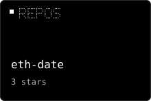

#### compact

`https://github.com/itsrealkaran/nothing-github-repos?username=itsrealkaran&theme=classic&size=compact`


#### regular

This is the default. You can leave `theme` and `size` off and get this card.

`https://github.com/itsrealkaran/nothing-github-repos?username=itsrealkaran&theme=classic&size=regular`

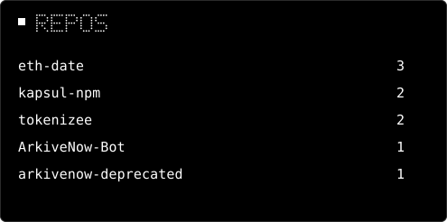

#### wide

`https://github.com/itsrealkaran/nothing-github-repos?username=itsrealkaran&theme=classic&size=wide`

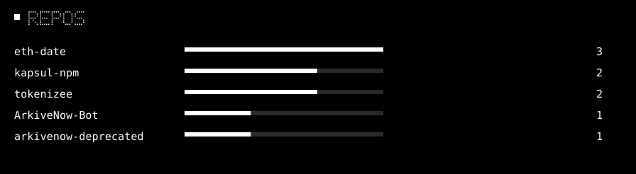

### classic-r

#### mini

`https://github.com/itsrealkaran/nothing-github-repos?username=itsrealkaran&theme=classic-r&size=mini`

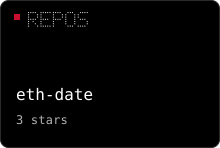

#### compact

`https://github.com/itsrealkaran/nothing-github-repos?username=itsrealkaran&theme=classic-r&size=compact`


#### regular

`https://github.com/itsrealkaran/nothing-github-repos?username=itsrealkaran&theme=classic-r&size=regular`

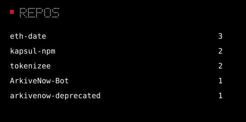

#### wide

`https://github.com/itsrealkaran/nothing-github-repos?username=itsrealkaran&theme=classic-r&size=wide`

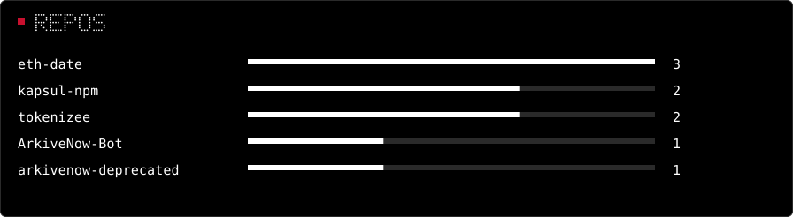

### white

#### mini

`https://github.com/itsrealkaran/nothing-github-repos?username=itsrealkaran&theme=white&size=mini`

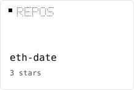

#### compact

`https://github.com/itsrealkaran/nothing-github-repos?username=itsrealkaran&theme=white&size=compact`


#### regular

`https://github.com/itsrealkaran/nothing-github-repos?username=itsrealkaran&theme=white&size=regular`

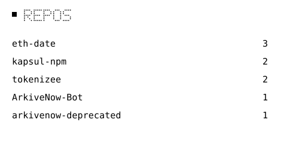

#### wide

`https://github.com/itsrealkaran/nothing-github-repos?username=itsrealkaran&theme=white&size=wide`

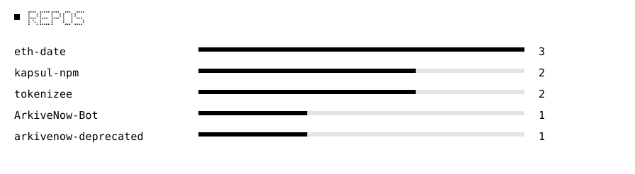

### white-r

#### mini

`https://github.com/itsrealkaran/nothing-github-repos?username=itsrealkaran&theme=white-r&size=mini`

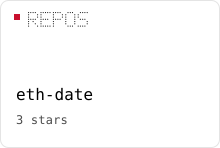

#### compact

`https://github.com/itsrealkaran/nothing-github-repos?username=itsrealkaran&theme=white-r&size=compact`


#### regular

`https://github.com/itsrealkaran/nothing-github-repos?username=itsrealkaran&theme=white-r&size=regular`

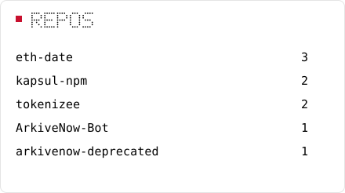

#### wide

`https://github.com/itsrealkaran/nothing-github-repos?username=itsrealkaran&theme=white-r&size=wide`

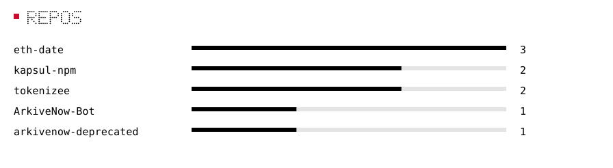

### light

#### mini

`https://github.com/itsrealkaran/nothing-github-repos?username=itsrealkaran&theme=light&size=mini`

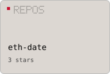

#### compact

`https://github.com/itsrealkaran/nothing-github-repos?username=itsrealkaran&theme=light&size=compact`


#### regular

`https://github.com/itsrealkaran/nothing-github-repos?username=itsrealkaran&theme=light&size=regular`

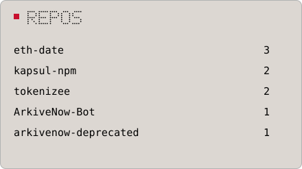

#### wide

`https://github.com/itsrealkaran/nothing-github-repos?username=itsrealkaran&theme=light&size=wide`

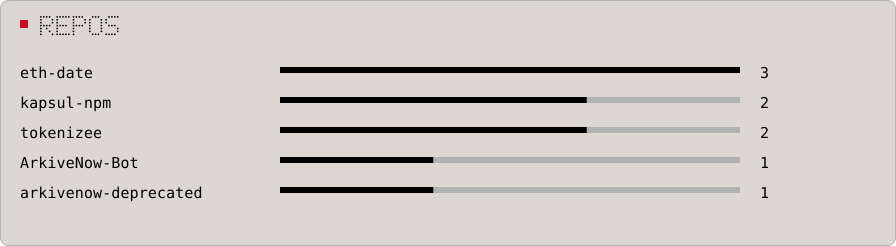

### red

#### mini

`https://github.com/itsrealkaran/nothing-github-repos?username=itsrealkaran&theme=red&size=mini`


#### compact

`https://github.com/itsrealkaran/nothing-github-repos?username=itsrealkaran&theme=red&size=compact`


#### regular

`https://github.com/itsrealkaran/nothing-github-repos?username=itsrealkaran&theme=red&size=regular`

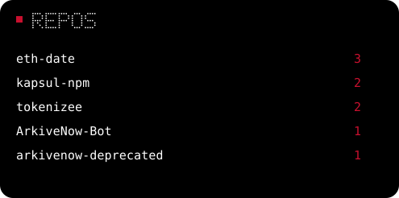

#### wide

`https://github.com/itsrealkaran/nothing-github-repos?username=itsrealkaran&theme=red&size=wide`

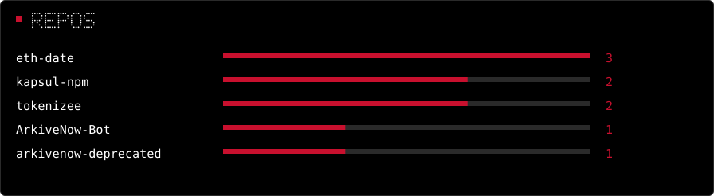

### blue

#### mini

`https://github.com/itsrealkaran/nothing-github-repos?username=itsrealkaran&theme=blue&size=mini`


#### compact

`https://github.com/itsrealkaran/nothing-github-repos?username=itsrealkaran&theme=blue&size=compact`


#### regular

`https://github.com/itsrealkaran/nothing-github-repos?username=itsrealkaran&theme=blue&size=regular`

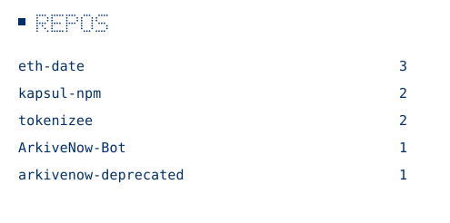

#### wide

`https://github.com/itsrealkaran/nothing-github-repos?username=itsrealkaran&theme=blue&size=wide`

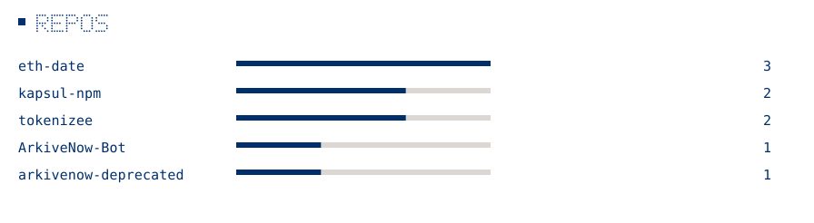

### yellow

#### mini

`https://github.com/itsrealkaran/nothing-github-repos?username=itsrealkaran&theme=yellow&size=mini`

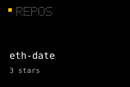

#### compact

`https://github.com/itsrealkaran/nothing-github-repos?username=itsrealkaran&theme=yellow&size=compact`


#### regular

`https://github.com/itsrealkaran/nothing-github-repos?username=itsrealkaran&theme=yellow&size=regular`

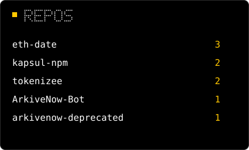

#### wide

`https://github.com/itsrealkaran/nothing-github-repos?username=itsrealkaran&theme=yellow&size=wide`

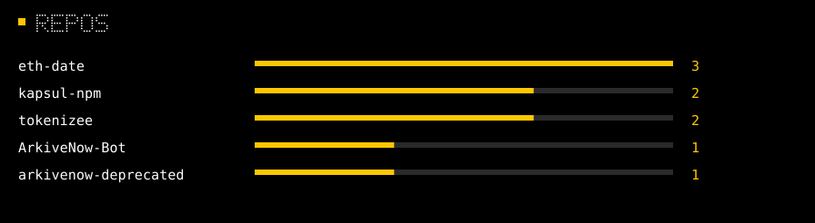

## Generate files

Write the SVG files into the repo when you want a fixed picture instead of a live URL.

```bash
python3 render.py itsrealkaran
```

Python 3 is enough. There is no package to install. Files land in `dist/<login>/`. Public numbers use `gh` when it is signed in on that machine, or `GH_TOKEN` / `GITHUB_TOKEN`.

## Run locally

The Python container and the Node server use the same path and the same query.

### Python container

```bash
docker build -t repos .
docker run --env GH_TOKEN --env PORT=8080 -p 8080:8080 repos
```

If the token is in a local `.env` file, pass that file instead:

```bash
docker run --env-file .env --env PORT=8080 -p 8080:8080 repos
```

The container runs `serve.py`. Open `http://127.0.0.1:8080/repos?username=itsrealkaran`.

The image does not include the `gh` command. Set `GH_TOKEN` when you start it. Without a token, GitHub allows about 60 requests an hour.

### Node

```bash
node server.js
```

The server listens on port `8080`. It reads `GH_TOKEN` from the environment, or from a `.env` file in this folder. `python3 render.py` remains the command that writes `dist/`.

Vercel and Netlify can host `server.js`. Set `GH_TOKEN` on the project. `vercel.json` is included. A free function has a short time limit. Use the Python container when a request needs longer than that limit.

## Deploy

Fork this repo for your own host. Your copy stays awake if a shared deploy sleeps, your traffic stays off a shared GitHub limit, and you can add a token for your own counts.

1. Fork the repo.
2. Deploy the Dockerfile on Fly, Railway, Render, Cloud Run, or a virtual machine. Or deploy `server.js` on Vercel or Netlify.
3. Set the variables below as secrets. Do not commit them.
4. Open `https://github.com/itsrealkaran/nothing-github-repos?username=yourname`.

Use that address in the image URL. The query stays the same.

## Configuration

| Variable | Required | Purpose |
| --- | --- | --- |
| `GH_TOKEN` | for a public server | GitHub token. `GITHUB_TOKEN` is the same variable. |
| `PORT` | no | Listen port. Default `8080`. |
| `CARD_CACHE_SECONDS` | no | How long a finished SVG is reused. Default `3600`. |

### Create a token

1. On GitHub, open Settings, then Developer settings, then Personal access tokens, then Tokens (classic).
2. Generate a new token.
3. Public cards need no extra scopes. The token raises the server limit from about 60 requests an hour to 5,000.
4. Set the value as `GH_TOKEN` on the host. Do not put it in the image URL, this README, or git.

## Private data

This card lists public repositories only. A private repository is never named and never counted.

## Contributing

This folder is the card: the drawing, the GitHub fetch, and both servers.

1. Fork the repo and edit `render.py`, or the files beside it when the change is the data or the colours.
2. Draw a sample with `python3 render.py yourname` and open `dist/yourname/`.
3. The live routes use that same drawing.
4. Do not commit a token, a `.env` file, or a private repository name.
5. Open a pull request and name the theme and size you checked.
